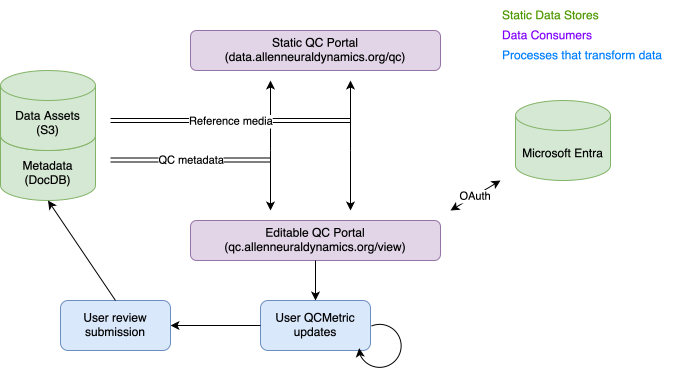

# Data Storage and Processing

## Code Ocean pipeline

Raw data lands in S3 as a single data asset that carries its `aind-data-schema`
metadata, with all of a session's modalities associated with one object.
Processing pipelines are modality-specific — each pipeline processes a single
modality and the `modalities` list in the associated data_description metadata 
should have length = 1 and contain a string representing only that single modality.
A pipeline outputs an NWB file along with `aind-data-schema` metadata,
including processing metrics and quality control artifacts and metrics.
All other metadata files should be identical to the raw asset metadata (e.g. the
acquisition metadata will contain data streams for all modalities that were collected
simultaneously, which will be a superset of the data streams that exist in the associated
single modality NWB file). 

Once QC is complete for all modalities, the single-modality outputs are combined into a single multimodal NWB file with merged metadata and saved as a new derived data asset. See [Combining single-modality assets](../policies_practices/data_organization.md#combining-single-modality-assets) for what triggers combining and what happens to the single-modality assets afterward.

Each pipeline wraps modality- and platform-specific libraries that handle the
underlying data processing, quality control, and NWB packaging.

### Common libraries

[aind-nwb-utils](https://github.com/AllenNeuralDynamics/aind-nwb-utils) : NWB File packaging manager.

[aind-metadata-manger](https://github.com/AllenNeuralDynamics/aind-metadata-manager) : Manages metadata generated in in each step of the pipeline and will output a complete, valid `aind-data-schema` metadata files at the end of the pipeline.

There are other tools but are common to modality / platform and not mentioned here.

## Quality control

Each pipeline produces quality control artifacts and metrics alongside its
processed outputs, captured in the asset's `aind-data-schema` metadata. These are
surfaced through the QC poratal where viewers can view and annotate their data assets.
data assets. The portal pulls QC metadata from the document database and displays
the corresponding reference figures from the Code Ocean data assets.

Reviewers use the portal to evaluate metrics marked `PENDING`, supporting AIND's
two-step quality control process: first assessing whether an asset's data is
suitable for analysis, then evaluating individual components (such as neurons)
within the asset for usability.

### Common libraries

[QC portal](https://github.com/AllenNeuralDynamics/aind-qc-portal) : A web application for viewing and annotating quality control metadata for AIND data assets.

