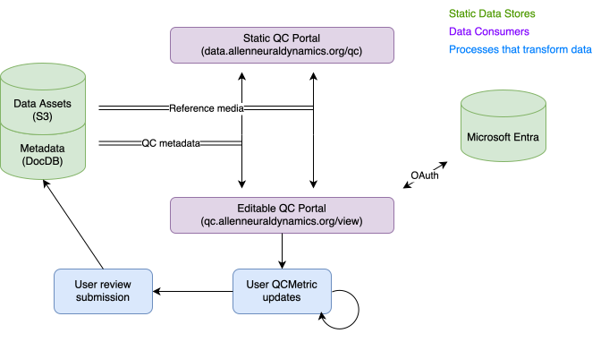

# Quality control

All data assets generated at AIND should undergo automated (and sometimes manual) quality control before being used in analysis. To make this as efficient as possible we provide a standardized metadata schema for tracking quality control metrics as well as a convenient portal for reviewing QC metadata.

## Preparing QC metadata

Please see the documentation on [QualityControl](https://aind-data-schema.readthedocs.io/en/latest/quality_control.html) for a comprehensive overview of QC.

## QC Portal

The QC Portal is a web app that allows users to explore the quality control metadata for data assets and, in edit mode, modify the value and state of metrics to annotate assets as passing or failing QC.

Please see the [QC Portal](https://github.com/AllenNeuralDynamics/aind-qc-portal?tab=readme-ov-file) documentation for more information.

## Ensure timely QC

It is important that any manual QC steps are performed in a timely manner. This ensures that any issues with data collection hardware/software are resolved quickly before affecting more data and that storage space is not spent on data that cannot be analyzed. Any data older than 6 months with metrics marked 'pending' or 'failed' (and which have not been marked as explicitly allowed to fail) are subject to deletion.
